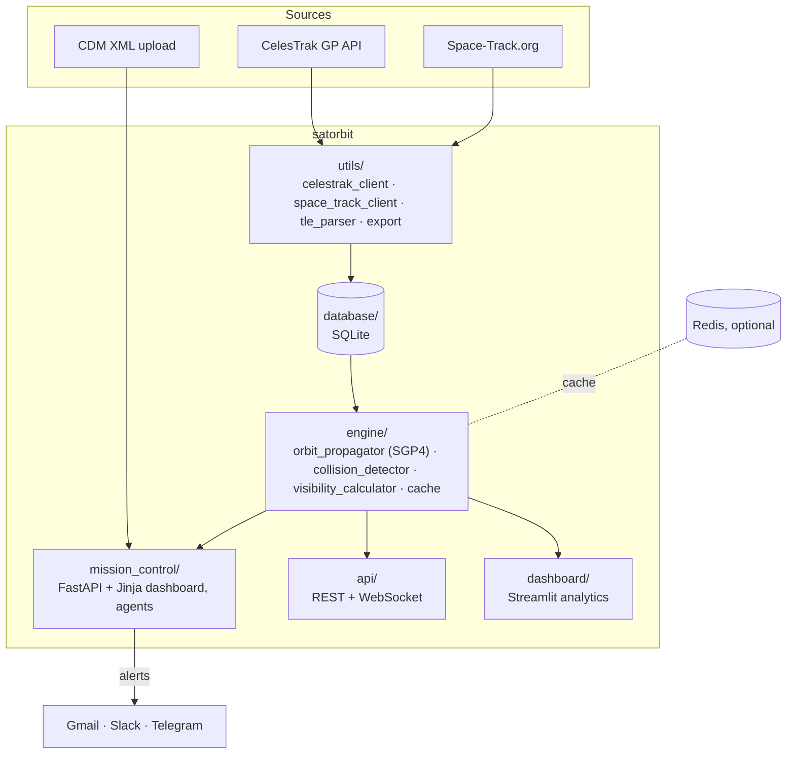

# Architecture

Satellite Orbit Tools is one Python package (`satorbit`) with three user
interfaces that share the same orbital-mechanics engine.



## Repository map

| Path | Purpose |
|---|---|
| `satorbit/cli.py` | `satorbit` command: `mission-control`, `init`, `sync`, `status`, `api`, `dashboard` |
| `satorbit/config.py` | Settings (pydantic-settings). Read from environment variables and `.env` |
| `satorbit/paths.py` | Data directory (`SATORBIT_HOME`, default `~/.satorbit`) |
| `satorbit/engine/` | SGP4 propagation (TEME → ECEF → geodetic), pairwise conjunction screening, pass prediction, Redis/in-memory cache |
| `satorbit/database/` | SQLite schema and data-access layer (satellites, ground stations, conjunction history, sync log) |
| `satorbit/utils/` | CelesTrak and Space-Track clients, TLE parsing and validation, CSV/HTML export |
| `satorbit/api/` | FastAPI app: `/api/v1/satellites`, `/api/v1/collision`, `/api/v1/visibility`, `/ws/track`, `/ws/alerts` |
| `satorbit/dashboard/` | Streamlit multi-page analytics app |
| `satorbit/mission_control/` | Operator dashboard and background agents (below) |
| `examples/` | Small stand-alone scripts that show the underlying libraries |
| `rust_engine/` | Experimental PyO3/Rayon collision kernel. Not wired into the Python package yet |
| `tests/` | pytest suite (offline: network calls are mocked) |

## Mission Control agents

All agents run inside the Mission Control process (`satorbit mission-control`).

| Agent | Implementation | Interval |
|---|---|---|
| **Commander** | `/chat` endpoint: intent matching over live state | on demand |
| **Guardian** | `guardian.run_conjunction_scan`: propagates tracked satellites and screens every pair, writes `conjunction-warning.csv` | every 5 min |
| **Notify** | `notify_agent.NotifyAgent`: urgent alerts when a pair is under 2 km, routine e-mail report | every 30 min |
| **Auto-Sync** | refreshes TLEs; a mean-motion jump > 0.005 rev/day is flagged as a possible maneuver | every 6 h |
| **Mission Log** | in-memory ring buffer (last 50 events) at `/api/logs` | real time |

## Data directory

```
$SATORBIT_HOME/                 (default ~/.satorbit, /data in Docker)
├── satellites.db               catalog used by the API and Streamlit dashboard
├── logs/
└── mission_control/
    ├── config.json             tracked satellites, ground station, alert settings
    ├── conjunction-warning.csv latest Guardian result
    ├── tle_cache/              per-satellite and active-catalog TLE cache
    └── maps/                   generated 2D/3D/sky-view HTML (served at /static)
```

On first start, `config.json` is created from
`satorbit/mission_control/config.example.json`.

## Conventions

- Times are UTC and timezone-aware.
- Distances are in km, velocities in km/s, angles in degrees, unless a name says otherwise.
- Secrets come from environment variables / `.env` (API, dashboard) or
  `config.json` (Mission Control alert channels). Never commit either.
- Tests must not need the network. Mock CelesTrak/Space-Track and the catalog lookup.
- Lint and format with `ruff check .` and `ruff format .`.
